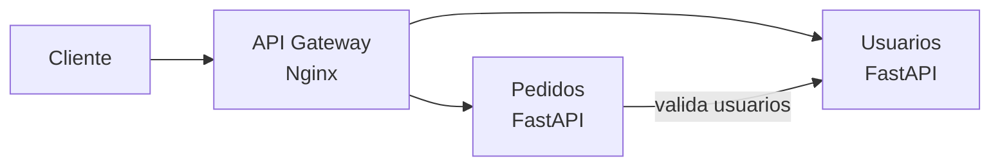

# Microservicios_API_Gateway
 
**Investigación: Microservicios y API Gateway**
 
Proyecto de investigación y demostración práctica sobre la arquitectura de **microservicios** y el patrón **API Gateway**, desarrollado para el curso **BIS-28** de la **Universidad Americana (UAM)**.
 
> **Eje 2:** Arquitectura y Backend Moderno
 
---
 
## Integrantes
 
| Nombre |
| --- |
| Stefan Corrales Hardley |
| Jarvio Lopez Mendoza |
| Heiner Chavarria Cameron |
 
---
 
## Introducción
 
Los microservicios son un estilo de arquitectura donde una aplicación se divide en **servicios pequeños e independientes** que se comunican entre sí por medio de **API**.
 
## ¿Qué problema resuelve?
 
La arquitectura tradicional, el **monolito**, presenta tres problemas principales:
 
| Problema | Descripción |
| --- | --- |
| **Monolito** | Todo vive en un solo bloque: un cambio pequeño obliga a desplegar toda la aplicación. |
| **Escalado** | Si una sola función recibe mucha carga, hay que escalar toda la aplicación. |
| **Fallos** | Un error en un módulo puede tumbar todo el sistema y frena a los equipos. |
 
## Conceptos clave
 
| Concepto | Definición |
| --- | --- |
| **Servicio** | Unidad pequeña con una sola responsabilidad. |
| **Gateway** | Puerta de entrada única: enruta y protege las peticiones. |
| **REST** | Los servicios se comunican por HTTP y JSON. |
| **Datos** | Cada servicio administra sus propios datos. |
| **Escalado** | Se replica solo el servicio que lo necesita. |
| **Docker** | Cada servicio corre aislado en un contenedor. |
 
> **Un servicio, una responsabilidad.**
 
---
 
## Flujo de la solución
 
El cliente envía su petición al **API Gateway** (Nginx), que la redirige al servicio correspondiente. Ambos servicios están construidos con **FastAPI**, y el servicio de **Pedidos** valida con el servicio de **Usuarios** antes de continuar.
 

 
## Pasos de la demo
 
1. **Levantar:** iniciar los contenedores con Docker.
2. **Petición:** el cliente llama al API Gateway.
3. **Enrutar:** el gateway enruta la petición al servicio correcto.
4. **Consultar:** el servicio de Pedidos consulta al de Usuarios.
5. **Validar:** Pedidos verifica que el usuario exista.
## Evidencia
 
El proyecto `microservicios_api_gateway` se ejecuta en **Docker Desktop**, con los servicios corriendo en contenedores aislados.
 
## Demo en vivo
 
Microservicio + API Gateway funcionando en tiempo real.
 
---
 
## Casos de uso reales
 
| Empresa | Uso de microservicios |
| --- | --- |
| **Amazon** | Equipos pequeños con servicios independientes. |
| **Netflix** | Dividió su plataforma en cientos de microservicios. |
| **Uber** | Microservicios para crecer por ciudades y equipos. |
| **Spotify** | Equipos autónomos dueños de sus servicios. |
 
## Herramientas y costos
 
| Herramienta | Uso | Costo |
| --- | --- | --- |
| **Docker** | Contenedores para correr cada servicio aislado. | Gratis para uso personal y educativo. |
| **Gateway** | Kong o Nginx: enruta y protege las peticiones. | Gratis (versión open source). |
| **Nube** | AWS o Azure, solo si se despliega en línea. | Capa gratuita; luego pago por uso. |
 
## Ventajas y limitaciones
 
**Ventajas**
- Cada servicio se despliega por separado.
- Los fallos pueden aislarse.
**Limitaciones**
- Más complejidad: red, monitoreo y consistencia de datos.
- Exige práctica en DevOps.
## Conclusiones técnicas
 
- **Separar:** cada servicio tiene una sola responsabilidad y se mantiene por separado.
- **Gateway:** un único punto de entrada simplifica la seguridad y el enrutamiento.
- **Balance:** se gana escalabilidad, pero cuesta más en complejidad y operación.
---
 
## Tecnologías utilizadas
 
- [Docker](https://www.docker.com/)
- [Nginx](https://nginx.org/) (API Gateway)
- [FastAPI](https://fastapi.tiangolo.com/) (servicios de Usuarios y Pedidos)
## Créditos
 
Proyecto realizado por **Stefan Corrales Hardley**, **Jarvio Lopez Mendoza** y **Heiner Chavarria Cameron**.
 
**BIS-28 · Universidad Americana (UAM)**
Eje 2: Arquitectura y Backend Moderno
